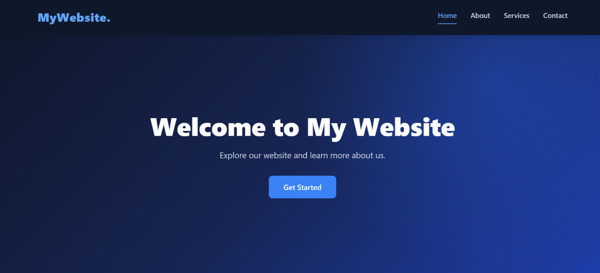
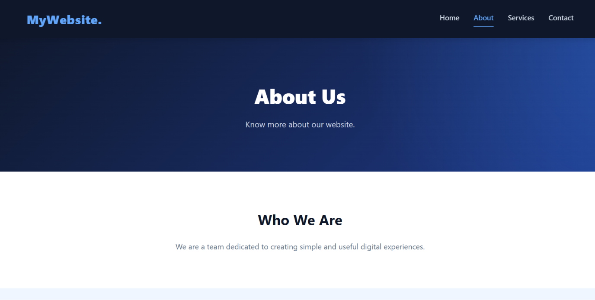
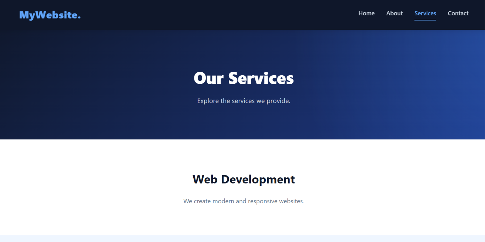
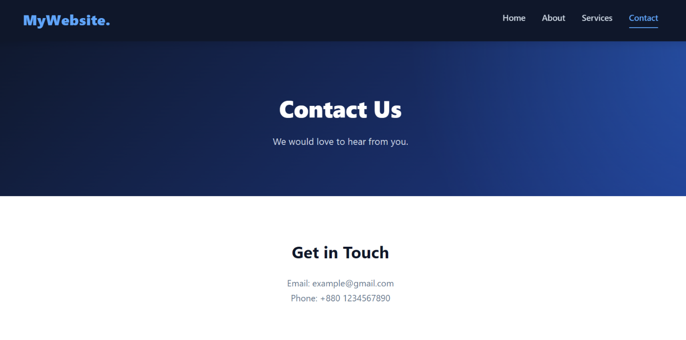

# 🚀 React Multi-Page Website

<p align="center">
  A modern, responsive multi-page website built with React and Vite.
  <br />
  Developed as part of the Ostad Full Stack Web Development with JavaScript (MERN) & AI course.
</p>

<p align="center">
  
  
  
  
</p>

---

## 📌 Overview

This project is a responsive multi-page website developed using **React.js** and **Vite**. It demonstrates fundamental React concepts, reusable components, client-side routing, and modern CSS styling.

The website features four individual pages with a consistent design system, shared navigation, and a responsive layout.

## ✨ Features

- **Multi-Page Navigation:** Four separate pages with React Router.
- **Reusable Components:** Shared Header and Footer components.
- **Modern UI:** Clean, dark-themed design with gradient accents.
- **Responsive Design:** Layout adapts to different screen sizes.
- **Interactive Elements:** Navigation states, hover effects, and contact form styling.
- **Component-Based Architecture:** Organized and maintainable React code.

## 📄 Pages

| Page | Description |
|---|---|
| 🏠 Home | Main landing page with a hero section |
| 👤 About | Information about the website |
| 🛠️ Services | Overview of available services |
| 📩 Contact | Contact information and form |

## 🧰 Technologies Used

| Technology | Purpose |
|---|---|
| React.js | Building the user interface |
| Vite | Development server and build tool |
| JavaScript (ES6+) | Application logic |
| React Router DOM | Client-side routing |
| HTML5 | Website structure |
| CSS3 | Styling and responsive layout |

## 📂 Project Structure

```text
my-react-website/
│
├── public/
│
├── src/
│   ├── components/
│   │   ├── Header.jsx
│   │   └── Footer.jsx
│   │
│   ├── pages/
│   │   ├── Home.jsx
│   │   ├── About.jsx
│   │   ├── Services.jsx
│   │   └── Contact.jsx
│   │
│   ├── App.jsx
│   ├── main.jsx
│   └── style.css
│
├── .gitignore
├── index.html
├── package.json
├── package-lock.json
└── vite.config.js
```

## ⚙️ Getting Started

Follow these instructions to run the project locally.

### Prerequisites

Make sure you have installed:

- [Node.js](https://nodejs.org/)
- npm (included with Node.js)
- Git

### 1. Clone the Repository

```bash
git clone https://github.com/Soumik-Riyan-Madhu/Module-16-Assignment.git
```

### 2. Navigate to the Project Directory

```bash
cd Module-16-Assignment
```

### 3. Install Dependencies

```bash
npm install
```

### 4. Start the Development Server

```bash
npm run dev
```

Open the local URL displayed in your terminal to view the website.

## 🏗️ Production Build

To create an optimized production build:

```bash
npm run build
```

To preview the production build locally:

```bash
npm run preview
```

## 📸 Screenshots

### 🏠 Home Page


### 👤 About Page


### 🛠️ Services Page


### 📩 Contact Page


## 🎯 Learning Objectives

Through this assignment, I practiced:

- Understanding React component architecture.
- Creating and organizing reusable components.
- Implementing page navigation with React Router.
- Working with JSX and JavaScript.
- Applying CSS for modern and responsive layouts.
- Managing a React project using Vite and npm.

## 👨‍💻 Author

**Soumik Riyan Madhu**

- GitHub: [@Soumik-Riyan-Madhu](https://github.com/Soumik-Riyan-Madhu)

## 🎓 Course Information

**Course:** Full Stack Web Development with JavaScript (MERN) & AI  
**Platform:** [Ostad](https://ostad.app/)  
**Assignment:** Module 16

---

<p align="center">
  Made with ❤️ using React
</p>
